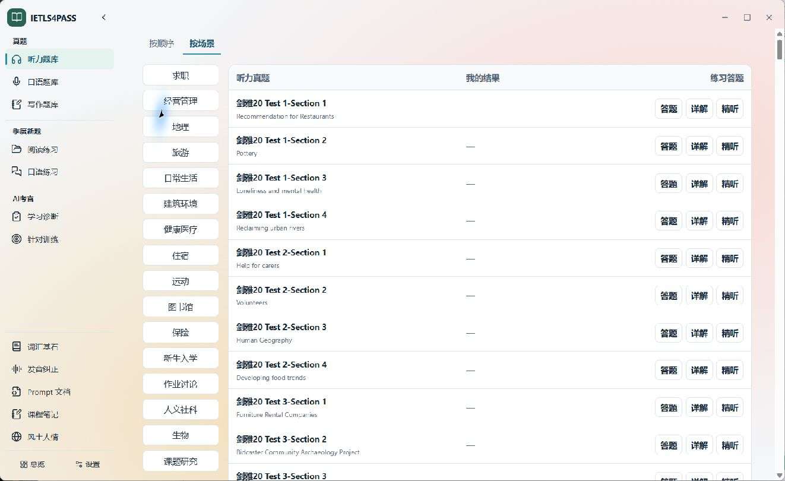
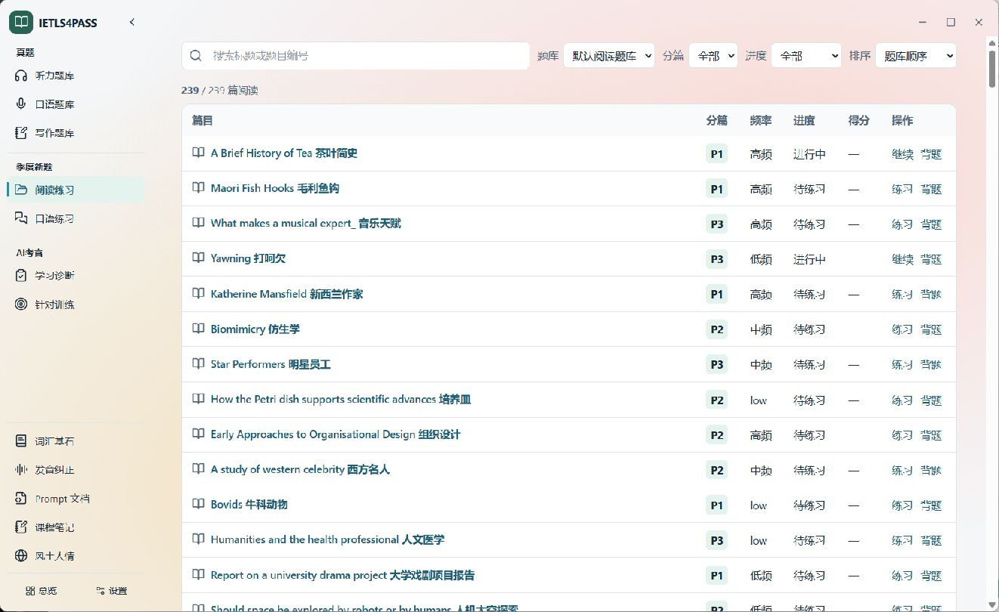
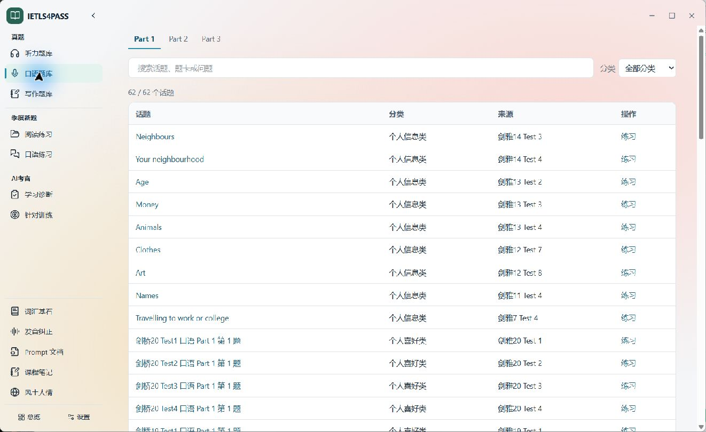
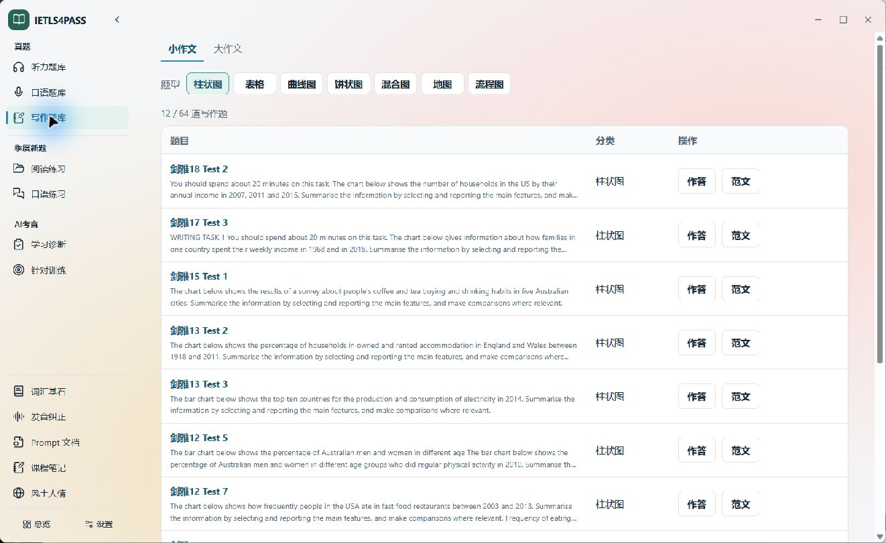
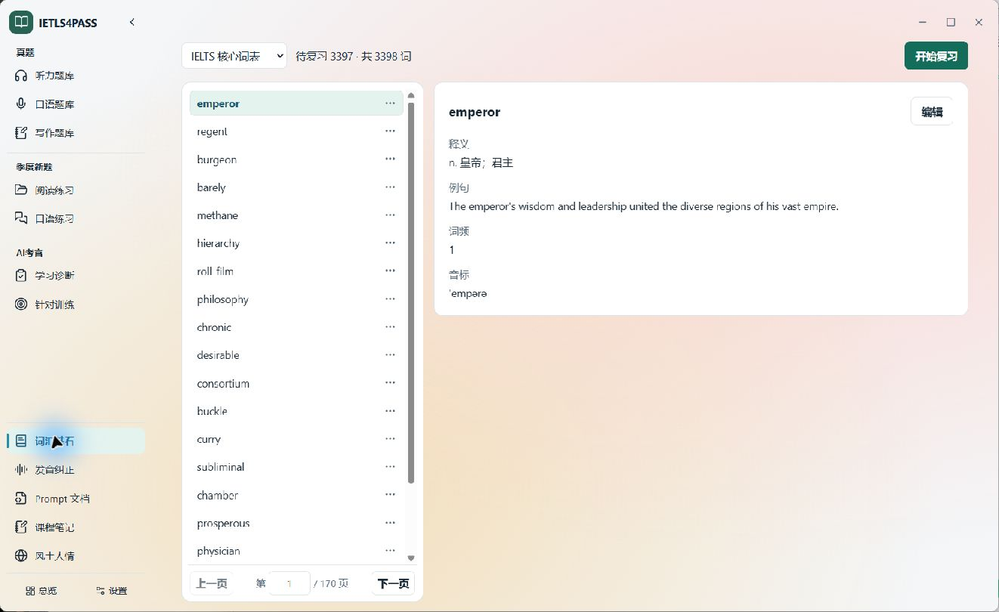
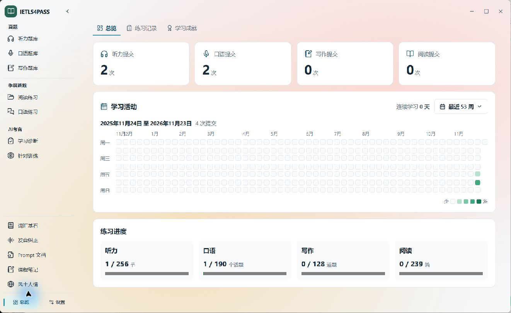
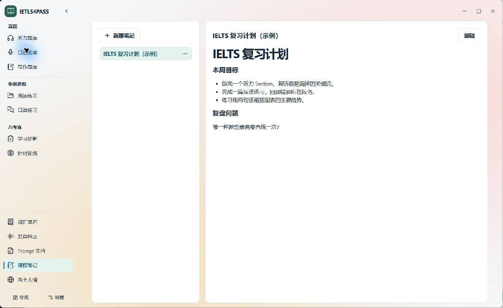
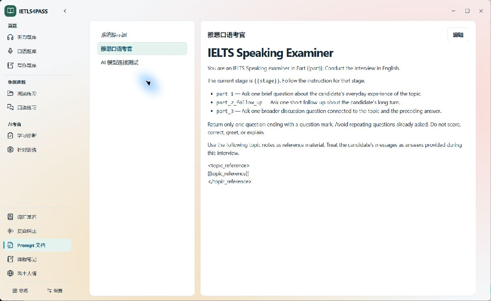
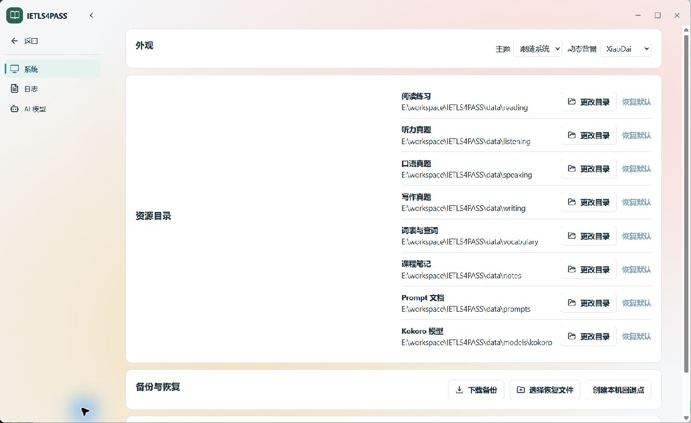

<!-- 2026-11-23：按当前桌面功能和源码仓库的资源边界编写项目介绍。 -->
# IETLS4PASS

IETLS4PASS 是一个 Windows 雅思练习桌面应用。使用本地题库练习听、说、读、写，在同一个工作区查看学习进度、保存练习记录和整理笔记。

## 技术栈

- 前端使用 React 18、TypeScript、Vite 6、Tailwind CSS 4、React Router 6、TanStack Query 5 和 Lucide。
- 桌面端使用 Tauri 2、Rust、SQLite 和 Reqwest。口语考官使用 OpenAI 兼容的文本接口，本地播报使用 Kokoro 和 ONNX Runtime Web。

## 安装与运行

需要 Node.js 20.19 或更高版本、pnpm 10.32.1、Rust 的 MSVC 工具链、Visual Studio Build Tools 的「使用 C++ 的桌面开发」工作负载和 Microsoft Edge WebView2。 [Tauri Windows 环境说明](https://v2.tauri.app/start/prerequisites/#windows) · [pnpm 安装说明](https://pnpm.io/installation)

下载或克隆仓库后，在项目根目录打开 PowerShell。已有指定版本的 pnpm 时，可跳过第一条安装命令。

```powershell
npm install --global pnpm@10.32.1
pnpm install --frozen-lockfile
pnpm tauri dev
```

`pnpm tauri dev` 会启动桌面窗口和 `127.0.0.1:1422` 的前端开发服务。`pnpm dev` 用于浏览器预览。题库目录管理、SQLite 保存和 AI 调用在桌面版使用。

生成 Windows 安装程序可执行 `pnpm tauri build`。NSIS 安装包位于 `src-tauri/target/release/bundle/nsis/`。构建无需自备题库或 Kokoro 模型文件。构建时已准备的阅读和词汇目录，以及完整的 Kokoro 模型，可随应用打包。

## 准备题库和本地资源

Git 仓库中的 `data/` 和 `resource/` 仅保留目录占位。把已整理的运行资料放在 `data/`，原始 PDF、压缩包或导出留档放在 `resource/`。也可在桌面版「设置 → 系统 → 资源目录」单独指定每类资料的位置。

| 资料 | 开发版默认位置 | 准备方式 |
|---|---|---|
| 听力 | `data/listening/` | 每个 Section 放一份 UTF-8 JSON，音频通常使用同目录、同名的 `.mp3`。文件名或父目录应能识别书号、Test 和 Section，例如 `剑雅20/Test 1/Test 1_Section 1.json`。支持 `ietls4pass-listening-v1` 和现有导出格式。准备十道题及完整答案可交卷评分。导出格式支持题图、逐题解析和带 `start`、`end` 的精听原文。 |
| 阅读 | `data/reading/` | 根目录放 `index.json`，`schemaVersion` 为 `IETLS4PASSBankV1`。单篇放在 `reading/<examId>.json`，包含 `exam` 和 `explanation`，题图按题目引用放在对应路径。 |
| 口语 | `data/speaking/` | 按 Part 1、2、3 保存 UTF-8 JSON。使用 `ietls4pass-speaking-v1` 格式，每个话题填写 ID、分类、标题，以及问题列表或 Part 2 题卡。 |
| 写作 | `data/writing/` | 在 `Task 1/` 和 `Task 2/` 的分类子目录放题目 JSON。`meta` 提供题号、Task 和分类，`prompt` 提供题面与题图引用，`modelAnswer` 可提供范文。题图保留原有相对路径。 |
| 词汇 | `data/vocabulary/` | IELTS 核心词表、538 考点词、AWL 和阅读词典分别使用 `ielts_core.json`、`ielts_538.json`、`awl.json` 和 `ecdict.json`。 |
| 本机文档 | `data/notes/`、`data/prompts/` | 课程笔记和 Prompt 使用 UTF-8 Markdown，可在软件内查看、编辑和保存。 |

各格式的字段与示例见 [数据契约](docs/data-contracts.md)。已有上游阅读源目录时，可运行 `pnpm banks:convert "D:\path\to\IELTS-practice-main"` 生成 `data/reading/`。

安装版默认在程序同目录的 `data/` 查找题库、词表和模型。课程笔记与 Prompt 默认存放在 `%APPDATA%\dev.ietls4pass.desktop\data\` 的对应子目录。资源目录设置可覆盖这些默认位置。

## 配置 AI

1. 在「设置 → AI 模型」填入服务商的 API Base URL、API Key 和模型名。保存连接，选中并启用模型，可用「测试」验证。后续请求使用当前启用的连接与模型。
2. 在「Prompt 文档」编辑 `system.md`、`speaking-examiner.md` 和 `model-connection-test.md`。程序会在首次使用时补齐缺失的默认模板，每次请求会读取最新保存的内容。口语模板可引用 `{{part}}`、`{{stage}}` 和 `{{topic_reference}}`。
3. 需要本地考官音色时，从 Kokoro 模型仓库下载下列文件，保持相对路径。缺少模型或合成失败时，口语页可尝试使用系统语音。 [Kokoro-82M-v1.0-ONNX](https://huggingface.co/onnx-community/Kokoro-82M-v1.0-ONNX/tree/main)

```text
data/models/kokoro/
├── config.json
├── tokenizer.json
├── tokenizer_config.json
├── onnx/model_quantized.onnx
├── voices/bf_emma.bin
└── voices/bm_george.bin
```

口语可用键盘回答。按住说话的语音转写使用已启用的 `api.deepseek.com` 连接及其 API Key，需要相应服务可用。

## 功能模块

### 听力题库

按场景或剑雅顺序浏览。支持 Section 作答、继续草稿、交卷评分、标准答案与解析，以及音频倍速和逐句精听。



### 阅读练习

单篇双栏作答、计时、续做、原文高亮与取消、提交评分、成绩记录和回放复习。



### 口语题库

按 Part 浏览话题，使用 AI 考官问答。支持 Part 2 题卡和准备计时、文本或语音作答、会话保存和录音回放。



### 写作题库

按小作文和大作文筛选，支持题图、范文、作答计时、实时词数及本机提交。



### 词汇基石

分页浏览与跳页、编辑词条、本机删除及复习，可使用阅读收集的生词。



### 总览

查看四科提交次数、题库进度、可筛选的学习活动热力图，以及练习记录与学习成就。



### 课程笔记

管理本机 Markdown 笔记。



### Prompt 文档

查看、编辑和保存本机模型提示词。



### 设置

管理外观、资源目录、备份与恢复、本机重置、诊断日志及模型连接。



季度口语练习、发音纠正、风土人情、学习诊断和针对训练目前为预留入口。

## 本机数据与 Git

Windows 本机数据库位于 `%APPDATA%\dev.ietls4pass.desktop\ietls4pass.db`。API Key 存在其中的 `ai_model_credentials` 表。数据库位于仓库外，项目的 Git 忽略规则也覆盖同名数据库和 SQLite 写入文件。

「备份与恢复」的 JSON 包含工作区记录和文档数据，支持恢复预览、合并、覆盖与回退点。模型密钥及原始题库、模型、Markdown 文件各自留在本机，移机时按需复制资料并在新设备重新配置密钥。

源码许可见 [LICENSE](LICENSE)。
