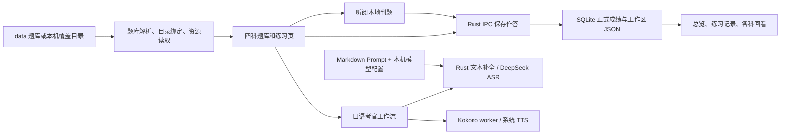

# 项目架构与证据清单

## 技术栈

| 项目 | 现状与证据 |
|---|---|
| 项目标识 | VERIFIED 产品名 IETLS4PASS，包名 ietls4pass，0.1.0，应用标识 dev.ietls4pass.desktop。`package.json`、`src-tauri/tauri.conf.json` |
| 前端 | VERIFIED React 18、TypeScript 5、Vite 6、Tailwind CSS 4 插件及项目 CSS、Lucide。`src/main.tsx`:1–23、`vite.config.ts`、`src/styles.css` |
| 桌面与后端 | VERIFIED Tauri 2、Rust 2021。Windows 主窗无原生装饰，使用 WebView2；NSIS 当前用户安装，引导程序按需下载 WebView2。Rust 使用 serde/serde_json、reqwest/rustls、rusqlite bundled。`src-tauri/Cargo.toml`、`src-tauri/tauri.conf.json` |
| 状态 | VERIFIED React state/ref 管理进行中交互，URL 查询串记录视图或选题，TanStack Query 管理 IPC 与文件数据读写缓存。全局查询默认 retry 1、staleTime 10 秒，部分题库单独启用焦点刷新、挂载刷新及约 8 秒轮询。工作区设置写 SQLite，侧栏折叠写 LocalStorage。`src/main.tsx`:9–11、`src/services/folderBanks.ts`、`src/app/App.tsx`:98,230 |
| IPC | VERIFIED `desktop.call` 包装 Tauri invoke、记录诊断。原生命令在 `main.rs` 的 generate_handler 注册，返回 JSON DTO 或二进制 Response。`src/services/desktop.ts`:166–244、`src-tauri/src/main.rs`:101–152 |
| SQL | VERIFIED 单连接 Mutex、WAL、参数绑定与事务，SQL migration 001–009。无 ORM 或服务端数据库。工作区文件为应用数据目录下的 ietls4pass.db。见 [数据库](06_DATABASE_AND_HISTORY.md) |
| 资源 | VERIFIED 本地 JSON、HTML、图片、MP3、词表、Markdown、模型-权重文件。认定路径经相对路径校验与 canonicalize，Rust 目录读取或 study-data 协议，前端媒体可转 blob URL。阅读与词汇可随构建打包，Kokoro 仅完整资源时打包；其他题库默认读取本机目录。`src-tauri/src/store/resources.rs`:30–99,220–280、`src-tauri/src/store/bank.rs`、`vite.config.ts`:18–68,74–120 |
| 配置 | VERIFIED `resource_directories` 可覆盖资源根，`bank_folders` 绑定读听说写目录。模型配置和密钥分表，Prompt/课程笔记为 Markdown。开发默认根是项目 data，正式构建的题库默认使用程序旁 data。正式版笔记和 Prompt 默认在用户 AppData 中，阅读、词汇与 Kokoro 可回退打包资源。`src-tauri/src/store/bank.rs`:69–102、`src-tauri/src/store/resources.rs`:30–44、`src-tauri/src/store/prompts.rs` |
| AI | VERIFIED OpenAI-compatible 文本适配器 + DeepSeek ASR + ONNX Runtime Web WASM/Worker 本地 Kokoro。当前只有考官业务调用文本模型，教师文档无运行时注册。见 [AI 基础设施](07_AI_INFRASTRUCTURE.md) |
| 测试与脚本 | VERIFIED package.json 没有 test script，检查范围内没有 Vitest、Jest、Playwright 或 Rust 业务 #[test] 套件。手工步骤在 `docs/acceptance.md`（部分历史说明以源码及实际库为准）。`scripts/verify-release.mjs` 校验题库、词典、许可与发布产物。无 UI 测试结果 |
| 启动与构建 | VERIFIED README 说明 Windows 需 Node ≥20.19、pnpm 10.32.1、Rust MSVC、Visual Studio Build Tools 的桌面 C++ 工作负载及 WebView2。`pnpm install --frozen-lockfile`、`pnpm tauri dev`（先执行 Vite，127.0.0.1:1422）、`pnpm tauri build`（调用 tsc --noEmit 和 vite build 后打包）。`pnpm dev` 单开渲染层，不具备 SQLite IPC。本次未运行这些命令 |

## 精简目录树

```text
IETLS4PASS/
├─ package.json / pnpm-lock.yaml / vite.config.ts
├─ src/
│  ├─ main.tsx / app/App.tsx             入口、侧栏、路由和 AI考官占位
│  ├─ domain/                          题库解析、评分、记录类型、统计与考官状态
│  ├─ features/
│  │  ├─ Listening*.tsx                听力题库、答题、详解与精听
│  │  ├─ Library.tsx / reading/         阅读题库、单篇答题、批注、回放
│  │  ├─ Speaking*.tsx / useSpeakingRecorder.ts / speakingAudio.js
│  │  ├─ WritingPractice.tsx / WritingExercise.tsx
│  │  ├─ Records.tsx / StudyOverview.tsx / LearningActivity.tsx
│  │  └─ AiModelSettings.tsx / PromptDocuments.tsx / MonthCalendar.tsx / NoteMarkdown.tsx
│  ├─ services/                       desktop IPC、题库、媒体、Kokoro worker
│  └─ styles.css
├─ src-tauri/
│  ├─ src/main.rs / src/store.rs        原生启动、命令、SQLite 根
│  ├─ src/store/                       bank、reading、listening、speaking、backup、
│  │                                    ai_models、prompts、resources、notes、diagnostics
│  ├─ src/llm.rs / src/llm/              文本补全、语音转写适配器
│  ├─ migrations/                     001 至 009
│  ├─ default-prompts/                 安装时可初始化的 Prompt
│  └─ capabilities/ / tauri.conf.json
├─ data/
│  ├─ listening/ reading/ speaking/ writing/
│  ├─ vocabulary/ models/kokoro/
│  └─ prompts/ notes/ skill-docs/       当前 Prompt、笔记、未接入的教师文档
├─ resource/                           原始资料；运行题库根由资源绑定决定
├─ scripts/                            题库转换与发布资源校验
└─ docs/                               数据契约、验收、迁移记录、本审计
```

四科共享 DTO、桌面/文件接口与历史导航，听力还复用阅读题面渲染及判分，写作复用阅读的 HTML 净化、媒体和计时。口语从模型和 Prompt 服务生成下一问，用户音频经转写后按回合写入。四科的历史在 Records 前端投影合并。见 [页面和接入点](08_UI_AND_INTEGRATION_POINTS.md)。



## 审计验证

- `git status --short` 记录已有未提交改动。用 `rg --files`、`rg -n`、`Get-Content -Encoding utf8` 核对上面目录与各报告标注的文件。审计以工作树为准，不以旧迁移文档或历史截图代替当前代码。
- 通过 `node --disable-warning=ExperimentalWarning -` 输入只读分析脚本。用 `DatabaseSync(path, { readOnly: true })`、`PRAGMA query_only=ON`、只读事务及聚合；`PRAGMA quick_check` 返回 `ok`，`user_version` 返回 9。没有读取凭据表的记录值。只取必要的题库、作答键和聚合，报告不输出个人作答内容。
- 通过 `node -` 递归读取实际题库 JSON，采样结构并统计题型、引用与存在性。覆盖 256 个听力 Section、239 篇阅读、190 个口语话题、128 道写作。没有进行抽取或下载。
- 通过 `node scripts/verify-release.mjs --assets-only` 检查本机题源。该模式校验 239 篇阅读、238 份解析、4 张阅读题图及 ECDICT 20229 项。
- 通过 `node -` 调用 TypeScript `createSourceFile`，确认 72 个 JS/TS 文件语法可解析且入口可达，51 个原生命令与前端调用相符。通过 `node -` 核对审计目录名目、本地链接、代码围栏和 JSON 样例。`git -c core.safecrlf=false diff --check` 通过；对照审计前状态，新增文件限本审计目录。按工作区约定未编译。没有启动 UI、执行迁移或实际请求任何模型。对语音权限、模型响应、回看渲染与安装端行为的运行状态为 **UNKNOWN**。
