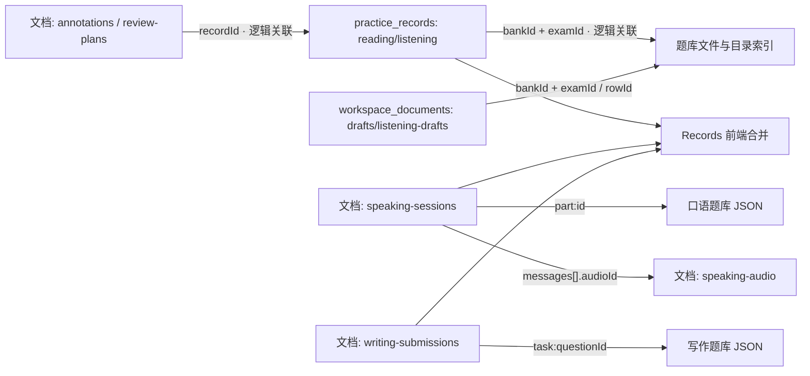

# 数据库、历史关系与数据质量

## 实际连接及审计范围

**VERIFIED** 源码由 `src-tauri/src/main.rs`:60–67 调用 Tauri `app_data_dir()`，`src-tauri/src/store.rs`:32–102 打开 `ietls4pass.db`，设置 SQLite WAL、5 秒忙等待并执行版本迁移。Windows 实查 `%APPDATA%/dev.ietls4pass.desktop/ietls4pass.db`，同目录存在 WAL/SHM。`%LOCALAPPDATA%/dev.ietls4pass.desktop` 未发现同名库。连接用 Node SQLite 只读模式与 query_only，读取包含 WAL 的正常视图，未运行应用迁移。该库 Schema 9、quick_check=ok。未检查其他用户、备份文件或另一机器的数据。题库位于文件系统，SQLite 目录索引仅保存绑定/可解析的相对元数据及工作区内容。

## 实际 DDL 与业务用途

括号内 `NN` 为 NOT NULL，`PK` 为主键，`UQ` 为唯一。无缺省值代表 SQL 未定义 DEFAULT。SQLite 整数主键在 PRAGMA 中 `notnull=0`，实际为 rowid 别名，插入 NULL 会分配 ID。以下来自真实库的 `table_info / index_list / index_info / foreign_key_list`，并核对 SQL migration 的 CHECK 和 DESC。

| 表及迁移 | 字段及约束 | 索引、外键、用途 |
|---|---|---|
| `practice_records`，001 | `id TEXT PK NN`、`submitted_at TEXT NN`、`record_json TEXT NN`，STRICT | PK 唯一，`practice_records_by_date(submitted_at DESC,id)` 非唯一，无 FK。听阅正式成绩。`store.rs::add_record/read_records`、`store/listening.rs` |
| `workspace_documents`，001 | `collection TEXT NN`、`id TEXT NN`、`document_json TEXT NN`，STRICT | `PK(collection,id)`，无 FK。各类工作区数据以 JSON 保存。`store.rs::list_documents/put_document` |
| `reading_draft_writers`，002 | `draft_id TEXT PK NN`、`attempt_id TEXT NN`、`writer_id TEXT NN`、`revision INTEGER NN CHECK >=0`，STRICT | 仅 PK，无 FK。草稿写者租约/版本，由 Rust 维护记录的一致性。`store/reading.rs` |
| `bank_folders`，003、005、006 | `id TEXT PK NN`、`kind TEXT NN`、`root TEXT NN`、`root_key TEXT NN`、`title TEXT NN`，STRICT。kind 为 reading/listening/speaking/writing | PK 与 `UQ(kind,root_key)`，无 FK。每次目录重绑的题库身份。`store/bank.rs` |
| `workspace_backups`，004 | `id INTEGER PK AUTOINCREMENT`、`source TEXT NN`（manual/before-replace）、`created_at TEXT NN DEFAULT UTC strftime`、`records INTEGER NN`、`documents INTEGER NN`、`backup_json TEXT NN CHECK json_valid` | 仅整数 PK，无 FK。备份/回退点，含练习隐私内容。`store/backup.rs` |
| `diagnostic_preferences`，004 | `id INTEGER PK CHECK id=1`、`enabled INTEGER NN CHECK IN(0,1)`、`detailed_until TEXT NULL`。迁移初始化 id=1, enabled=1 | 无额外索引/FK。日志设置。`store/diagnostics.rs` |
| `diagnostic_events`，004 | `id INTEGER PK AUTOINCREMENT`、`occurred_at TEXT NN DEFAULT UTC strftime`、`operation TEXT NN`、`result TEXT NN CHECK IN('error','ok')` | 无额外索引/FK。仅计诊断事件，不是答题事件日志。`store/diagnostics.rs` |
| `ai_model_connections`，007、008 | `id INTEGER PK AUTOINCREMENT`、`name/base_url/model TEXT NN`、`active INTEGER NN CHECK IN(0,1)`、`models_json TEXT NN DEFAULT '[]'`、`generation_parameters_json TEXT NN DEFAULT '{}'`、`timeout_seconds INTEGER NN DEFAULT 120 CHECK 5..600`，STRICT | 部分唯一索引 `ai_model_one_active(active) WHERE active=1`。设置与运行时连接元数据。`store/ai_models.rs` |
| `ai_model_credentials`，007 | `connection_id INTEGER PK`、`api_key TEXT NN`，STRICT | `connection_id → ai_model_connections.id ON DELETE CASCADE`。本机凭据，未查询任何行。删除连接命令也显式清理凭据。`store/ai_models.rs` |
| `resource_directories`，009 | `kind TEXT PK NN`、`root TEXT NN`，STRICT | 仅 PK，无 FK。设备路径覆盖。实查无覆盖项。`store/resources.rs` |

迁移顺序实际为 001 正式成绩与文档、002 写者、003 目录、004 备份与日志、005 口语绑定、006 写作绑定、007 AI 连接、008 模型变体和参数、009 资源目录。全部在 `Database::open` 同一事务内按起始版本升级。没有独立题目、单题答案、错因、分析、诊断报告、薄弱点、专项训练或训练结果业务表。日志表只记软件操作结果。

## JSON 集合与字段

| 集合或设施 | 当前结构与业务关联 | 已观察记录数 |
|---|---|---|
| `drafts` | 键 `bankId:examId`，值 `PracticeDraft`，含 UUID id、答案、已累计用时、读题时长归属、批注、可能有 pendingResult。写者表以草稿键绑定 | 2 |
| `listening-drafts` | 键 `ListeningRow.id`，值 `ListeningDraft`，含作答、位置（秒）、用时（毫秒）、版本、题面高亮 | 3 |
| `listening`、`banks` | ID 为题库来源，保存目录相对索引或旧格式的听力题源、阅读导入资产等 | 1、0 |
| `listening-highlights` | 题面 `question:<recordId>`，原文 `transcript:<rowId>`，值为 `PassageHighlight[]`。精听原文批注为同节共享 | 0 |
| `annotations`、`review-plans` | 正式单篇的回放批注按成绩 ID，文章复习计划按题库与篇目，引用作为复习依据的成绩 ID | 0、0 |
| `speaking-sessions` | `SpeakingSession`，UUID/版本、`part:topicId`、消息数组、阶段、时间、结束原因、可选音色 | 5 |
| `speaking-audio` | 键 audioId，值 `{sessionId, wav}`，WAV Base64，需关联相同 sessionId 下的用户消息 | 0 |
| `writing-submissions` | 键为提交 UUID，`{id,task,questionId,title,answer,submittedAt}`。无 JSON 中的独立题库/版本/时间字段 | 0 |
| `settings` | 常见包含外观、选中题库、偏好、考试目标 `ielts-exam-plan`。题库绑定、模型凭据另表。此处仅给总数，不读用户目标值 | 3 |
| `vocabulary`、`vocabulary-edits`、`achievements` | 复习进度、词条覆盖与删除标记、解锁标识。`reading-words` 可关联 bankId/examId，当前 0 | 17、549、2 |
| 历史 `interrupted` | 旧归档在这份已存在的数据库中仍有行。当前代码的活动文档过滤不向应用提供该集合 | 5 |

脱敏实样为一行 `practice_records` 中的听力成绩。`submittedAt` 和 `startedAt` 为字符串、`elapsedMs` 为整数、`examId` 是 Cambridge 形式、`answers` 是 10 项题号键映射。逐题行实际字段为 `{questionId,label,userAnswer,correctAnswer,points,possible,type}`，本报告隐去 ID、值和时间。口语实样的 `messages` 数组只见 `role=assistant`，会话存在 `phase/elapsedMs/revision/topicId/startedAt/updatedAt`。无写作或音频实样可列，字段来自定义。相关存储的实际代码见 [源码摘录](11_KEY_SOURCE_EXTRACTS.md)。

## 四科真实关系

**VERIFIED** `desktop.records()` 按时间倒序取全部听阅，Rust 排除旧套题。`desktop.documents<T>(collection)` 读取指定集合。`Records` 先取三路并投影为 `ListedPracticeRecord`，口语取 `updatedAt` 作为投影提交时间，写作为真实 `submittedAt`。读取结束口语的规则是 `phase === "finished" && messages.some(role === "user")`。UI 有科目/搜索，无跨科后端分页、按时间范围、按题型或来源的历史查询接口。总览活动在客户端筛日期，并非后端时间范围查询。重复练习为新提交 ID，首次/重复状态按可靠题目身份与时间排序推导，旧记录删减或身份漂移时只能说“可见历史中的首次”。

**VERIFIED** 备份格式 `ietls4pass-backup-v1` 以 SHA-256 核对原件，兼容无校验早期文件。支持合并、覆盖前回退点、预览后检查版本变动。练习、可续做草稿、口语附件与写作提交在范围内，模型连接/密钥、原生资源绑定、Markdown 文件在范围外。旧套题、旧中断归档及可识别的关联回放资料经当前代码过滤。旧上游 v1/v2 的导入走 `legacyImport.ts`、`legacyWorkspace.ts`，部分源字段可能无法补齐。

## 本机数据质量快照

| 指标 | 听力 | 阅读 | 口语 | 写作 |
|---|---|---|---|---|
| 正式练习 | 1 | 0（另有 2 份草稿） | 0（5 会话，3 已结束，5 条考官消息，0 用户消息，全为 Part 1） | 0 |
| 正式有内容的作答量 | 10，判题项 10 | 0 | 0 用户回合 | 0 作文 |
| 历史 AI 教师分析 | 0，功能未接入 | 0 | 0，考官问题属对话消息 | 0 |
| 正式缺题 ID / 当前目录未回溯 | 0 / 0。用 bankId 与 Cambridge ID 匹配 256 项索引，资源存在 | 无正式样本 | 无正式样本 | 无正式样本 |
| 正式缺用户答案 / 时间不可确定 | 0 / 0。该条有日期与毫秒用时 | 无正式样本 | 无正式样本；5 会话开始/更新日期均可解析 | 无正式样本 |
| 重复/孤立 | 主键重复 0，现有题的正式重复 0 | 写者孤立 0 | 录音文档 0、孤立录音 0 | 无正式样本 |

历史质量统计以活动定义为准，旧归档另列。0 行不能证明网上来源授权、录音保存成功率或其他设备的历史完整。没有验证同秒/跨时区日期在真实多次作答下的比较表现。诊断日志、模型设置和备份关于敏感数据只查了表结构。
